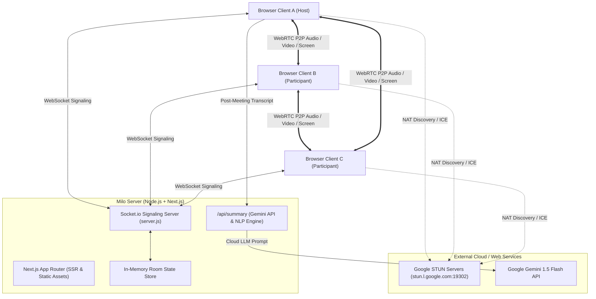
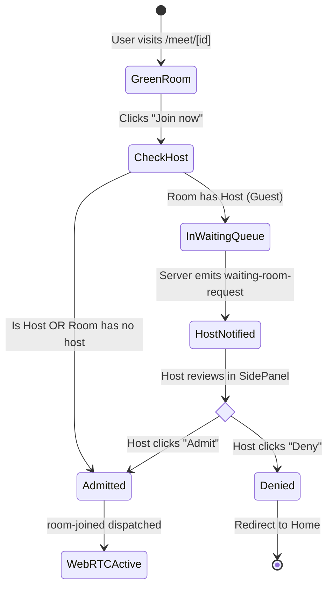

# 🏗️ Milo — System Architecture & Protocol Specification

This document outlines the software architecture, data flow diagrams, WebRTC signaling protocol contracts, and state machines powering **Milo**.

---

## 1. High-Level Architecture Overview

---

## 2. WebRTC Mesh Signaling Protocol (Socket.io)

Milo runs an in-memory stateful signaling protocol over Socket.io. All media passes directly between browsers (P2P Mesh), while coordination, state, chat, whiteboard, and lobby approvals pass through the signaling server.

### 2.1 Signaling Events Specification

| Event Name | Direction | Payload Schema | Description |
| :--- | :---: | :--- | :--- |
| `join-room` | Client ➔ Server | `{ roomId, userName, isHostIntent }` | Initiates entry request for a given room. First entrant or `isHostIntent=true` is designated Host. |
| `waiting-for-host` | Server ➔ Client | *none* | Sent to guest if room already has a host and requires lobby approval. |
| `waiting-room-request` | Server ➔ Host | `{ peerId, userName, userAvatar }` | Notifies the host that a guest is waiting in the lobby. |
| `host-lobby-decision` | Host ➔ Server | `{ roomId, targetPeerId, approved: boolean }` | Host's decision to admit or deny a waiting guest. |
| `lobby-denied` | Server ➔ Guest | `{ reason }` | Informs the waiting guest their admission was denied. |
| `room-joined` | Server ➔ Client | `{ roomId, peerId, isHost, participants, chatHistory, whiteboardStrokes, breakoutRooms }` | Dispatched to an admitted user with initial room state and list of existing peers. |
| `user-connected` | Server ➔ Room | `{ id, userName, audio, video, handRaised, isHost }` | Broadcast to existing participants that a newcomer has entered. Existing peers initiate WebRTC offers. |
| `signal` | Client ⇄ Server | `{ to, from, signal: { type: 'offer'\|'answer'\|'candidate', sdp\|candidate } }` | Relays SDP descriptions and ICE candidates between peers. |
| `toggle-media` | Client ➔ Server | `{ roomId, type: 'audio'\|'video', enabled: boolean }` | Synchronizes mute/cam state changes to participant cards. |
| `send-message` | Client ➔ Server | `{ roomId, text, senderName }` | Dispatches in-meeting ephemeral text chat messages. |
| `send-reaction` | Client ➔ Server | `{ roomId, emoji, senderName }` | Triggers real-time floating emoji bubbles on all client screens. |
| `toggle-hand` | Client ➔ Server | `{ roomId, raised: boolean, senderName }` | Raises or lowers hand with badge notification. |
| `whiteboard-draw` | Client ➔ Server | `{ roomId, stroke: { fromX, fromY, toX, toY, color, width, tool } }` | Real-time stroke broadcasting for collaborative Milo Board. |
| `whiteboard-clear` | Client ➔ Server | `{ roomId }` | Clears collaborative canvas for all attendees. |
| `send-caption` | Client ➔ Server | `{ roomId, text, lang, senderName }` | Dispatches real-time speech subtitles across the room and records in transcript log. |
| `create-breakout-rooms`| Host ➔ Server | `{ roomId, count: number }` | Divides call participants into breakout rooms. |
| `user-disconnected` | Server ➔ Room | `{ peerId, userName }` | Broadcast when a peer closes tab or leaves call. Triggers WebRTC connection cleanup. |

---

## 3. Host Waiting Room State Machine

---

## 4. Media Pipeline & Bandwidth Throttling (Low Data Mode)

Milo dynamically adjusts media constraints using the `RTCRtpSender` API without resetting the WebRTC peer connection:

### Standard HD Profile:
- **Video Resolution:** Ideal 1280x720 @ 30fps
- **Bitrate Cap:** 1,500,000 bps (1.5 Mbps)
- **Audio Profile:** Stereo Opus @ 48kHz (64 kbps)

### Low Data Saver Profile:
- **Video Resolution:** Scaled down to 360p / 15fps max
- **Bitrate Cap:** `encodings[0].maxBitrate = 120000` (120 kbps)
- **Framerate Cap:** `encodings[0].maxFramerate = 15`
- **Fallback:** If camera is toggled off, video track is disabled, reducing bandwidth strictly to compressed audio (~32 kbps).

---

## 5. AI Meeting Summary Pipeline

1. **Capture:** Every spoken sentence via `LiveCaptions.jsx` and sent chat message via `SidePanel.jsx` is logged in an in-memory chronological array.
2. **Post-Call Trigger:** When a user leaves or clicks "Generate AI Summary Now", a `POST` request is sent to `/api/summary`.
3. **Synthesis Engine:**
   - **Primary:** If `GEMINI_API_KEY` is present, prompts Google Gemini 1.5 Flash to generate an executive overview, Hindi summary, key decisions, and action items.
   - **Secondary (Deterministic Fallback):** If no API key is supplied, a built-in NLP engine groups speaker contributions, timestamps, and extracted commitments into a markdown report.
4. **Delivery:** The user receives a modal with one-click **Copy to Clipboard** and **Download Markdown (`.md`)** buttons.
