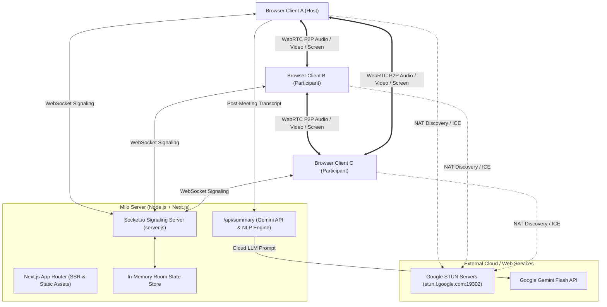
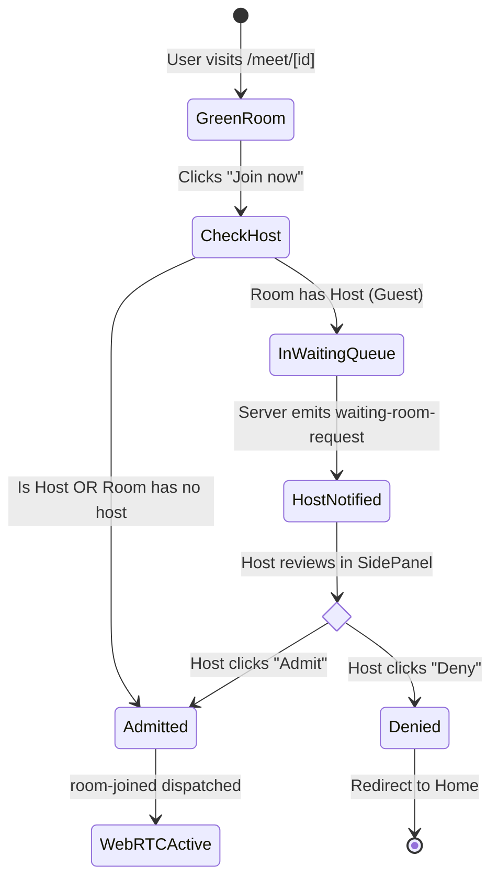

# 🏗️ Milo — System Architecture & Protocol Specification

This document outlines the software architecture, data flow diagrams, WebRTC signaling protocol contracts, and state machines powering **Milo**.

---

## 1. High-Level Architecture Overview

---

## 2. WebRTC Mesh Signaling Protocol (Socket.io)

Milo runs an in-memory stateful signaling protocol over Socket.io. All media passes directly between browsers (P2P Mesh), while coordination, state, chat, whiteboard, and lobby approvals pass through the signaling server.

**Deployment topology:** the signaling server is long-lived stateful process (`server.js`), so it cannot run in Vercel serverless functions. The client connects to `NEXT_PUBLIC_SIGNALING_URL` when set and otherwise to its own origin. Host signaling on a persistent Node host (Render/Railway/Fly), and point the Vercel frontend at it. For single-host deployments, `server.js` serves both Next.js and Socket.io.

### 2.1 Signaling Events Specification

| Event Name | Direction | Payload Schema | Description |
| :--- | :---: | :--- | :--- |
| `join-room` | Client ➔ Server | `{ roomId, userName, isHostIntent }` | Initiates entry request for a given room. First entrant or `isHostIntent=true` is designated Host. |
| `waiting-for-host` | Server ➔ Client | *none* | Sent to guest if room already has a host and requires lobby approval. |
| `waiting-room-request` | Server ➔ Host | `{ peerId, userName, userAvatar }` | Notifies the host that a guest is waiting in the lobby. |
| `host-lobby-decision` | Host ➔ Server | `{ roomId, targetPeerId, approved: boolean }` | Host's decision to admit or deny a waiting guest. |
| `lobby-denied` | Server ➔ Guest | `{ reason }` | Informs the waiting guest their admission was denied. |
| `room-joined` | Server ➔ Client | `{ roomId, peerId, isHost, participants, chatHistory, whiteboardStrokes, breakoutRooms }` | Dispatched to an admitted user with initial room state and list of existing peers. |
| `user-connected` | Server ➔ Room | `{ id, userName, audio, video, handRaised, isHost }` | Broadcast to existing participants that a newcomer has entered. Existing peers initiate WebRTC offers. |
| `signal` | Client ⇄ Server | `{ to, from, signal: { type: 'offer'\|'answer'\|'candidate', sdp\|candidate } }` | Relays SDP descriptions and ICE candidates between peers. |
| `toggle-media` | Client ➔ Server | `{ roomId, type: 'audio'\|'video', enabled: boolean }` | Synchronizes mute/cam state changes to participant cards. |
| `send-message` | Client ➔ Server | `{ roomId, text, senderName }` | Dispatches in-meeting ephemeral text chat messages. |
| `send-reaction` | Client ➔ Server | `{ roomId, emoji, senderName }` | Triggers real-time floating emoji bubbles on all client screens. |
| `toggle-hand` | Client ➔ Server | `{ roomId, raised: boolean, senderName }` | Raises or lowers hand with badge notification. |
| `whiteboard-draw` | Client ➔ Server | `{ roomId, stroke: { fromX, fromY, toX, toY, color, width, tool } }` | Real-time stroke broadcasting for collaborative Milo Board. |
| `whiteboard-clear` | Client ➔ Server | `{ roomId }` | Clears collaborative canvas for all attendees. |
| `send-caption` | Client ➔ Server | `{ roomId, text, lang, senderName }` | Dispatches real-time speech subtitles across the room and records in transcript log. |
| `create-breakout-rooms`| Host ➔ Server | `{ roomId, count: number }` | Divides call participants into breakout rooms. |
| `user-disconnected` | Server ➔ Room | `{ peerId, userName }` | Broadcast when a peer closes tab or leaves call. Triggers WebRTC connection cleanup. |

### 2.2 ICE Candidate Ordering Guarantee

Trickle ICE candidates may reach a peer **before** the associated SDP offer/answer. The client `WebRTCManager` (`lib/webrtc.js`) therefore keeps a per-peer `pendingCandidates` queue and a `remoteDescriptionSet` flag; candidates are buffered until the remote description is applied, then flushed in order. An inbound offer received while a local offer is pending triggers a `setLocalDescription({ type: 'rollback' })` (glare handling) so exactly one negotiation path survives. This guarantees bidirectional media on the first connection attempt.

---

## 3. Host Waiting Room State Machine

---

## 4. Media Pipeline & Bandwidth Throttling (Low Data Mode)

Milo dynamically adjusts media constraints using the `RTCRtpSender` API without resetting the WebRTC peer connection:

### Standard HD Profile:
- **Video Resolution:** Ideal 1280x720 @ 30fps
- **Bitrate Cap:** 1,500,000 bps (1.5 Mbps)
- **Audio Profile:** Stereo Opus @ 48kHz (64 kbps)

### Device Switching (mic / camera):
`DeviceMenu.jsx` enumerates `audioinput` / `videoinput` devices and shows the active one. Selecting a device calls `getUserMedia({ deviceId: { exact } })`, rebuilds `localStream` with the new track, and applies it to every peer via `sender.replaceTrack()` — no renegotiation, no call interruption. The control bar and green room both expose these pickers.

### Negotiation Robustness:
`setLocalStream()` often resolves while the initial offer/answer is still in flight. If senders must be added in that window, the peer is recorded in `pendingNegotiations` and offered as soon as `onsignalingstatechange` reports `stable`; offering immediately (or dropping the attempt) produced intermittent one-way video. Remote tracks are de-duplicated per kind so a stale ended track can never sit at index 0 of a reused `MediaStream` and blank the tile, and each tile calls `play()` explicitly because autoplay may be deferred while the avatar fallback is shown.

### Whiteboard Stroke Smoothing:
Each freehand stroke carries a `strokeId`; segments are `{ strokeId, fromX, fromY, toX, toY, color, width, tool }`. Both sides render **midpoint-quadratic curves** (move to previous midpoint → quadratic through previous point → end at new midpoint), so sender and receiver produce pixel-identical smooth curves. Pointer Events + `getCoalescedEvents()` capture high-frequency input.

### Nib-Accurate Cursor & Canvas Sizing:
The pen/eraser is a DOM `` inside the board, positioned from the same canvas-local pointer coordinates used for painting — the nib tip (4, 24 in the 28 px icon) is therefore always on the ink. The native OS cursor is hidden (`cursor: none`); OS cursor hotspots drift from the drawn tip on HiDPI/Windows scaling. The canvas buffer is kept equal to the rendered size (× devicePixelRatio) via `ResizeObserver`, and the context is scaled by the exact `buffer / CSS` ratio, so stroke coordinates stay in CSS pixels and never drift from the pointer. Locally drawn segments are kept in a ref so the board can be replayed after a resize.

### Device Menu Overlay Positioning:
`DeviceMenu.jsx` renders its dropdown through `createPortal` into `document.body` with `position: fixed`. Placement is clamped to the viewport with a 12 px margin, anchored to the chevron's right edge, and flips below the chevron when there is no room above; it re-measures on scroll/resize. This keeps the list fully visible even inside the green-room video card (`overflow: hidden`) or at a screen edge. The menu has a fixed 300 px width and device labels truncate with an ellipsis.

### Persisted Preferences:
`lib/settings.js` stores `{ displayName, microphoneId, cameraId, speakerId, lowDataDefault, captionLanguage }` in `localStorage` under `milo.settings`. The header-gear settings dialog (`SettingsModal.jsx`) edits them live with a microphone test meter and camera preview. `app/meet/[id]/page.jsx` reads them on mount to pre-select devices, pre-fill the display name, start in Low Data mode when configured, and pass the default caption language to `LiveCaptions`.

### Low Data Saver Profile:
- **Video Resolution:** Scaled down to 360p / 15fps max
- **Bitrate Cap:** `encodings[0].maxBitrate = 120000` (120 kbps)
- **Framerate Cap:** `encodings[0].maxFramerate = 15`
- **Fallback:** If camera is toggled off, video track is disabled, reducing bandwidth strictly to compressed audio (~32 kbps).

---

## 5. AI Meeting Summary Pipeline

1. **Capture:** Finalized speech results from `LiveCaptions.jsx` and sent chat messages from `SidePanel.jsx` are logged in an in-memory chronological array. Interim recognition fragments are shown on screen but deliberately excluded from the transcript so summaries stay coherent. The logger callback is held in a ref, so parent re-renders never restart `SpeechRecognition` and lose a phrase mid-sentence.
2. **Post-Call Trigger:** When a user leaves or clicks "Generate AI Summary Now", a `POST` request is sent to `/api/summary`.
3. **Synthesis Engine:**
   - **Primary:** If `GEMINI_API_KEY` is present (`.env.local`, process env, or a key pasted into the AI Notes tab), the route prompts Gemini Flash (default `gemini-2.5-flash`, override with `GEMINI_MODEL`) for an executive overview, Hindi summary, key decisions, and action items.
   - **Secondary (Deterministic Fallback):** With no key — the default out-of-the-box state — a built-in NLP engine runs immediately and returns a complete markdown report (`mode: "smart-local"`). AI Notes never requires paid cloud setup.
4. **Delivery:** The AI Notes tab renders the summary inline; leaving the call opens `AISummaryModal` with **Copy to Clipboard** and **Download Markdown (`.md`)**. Closing that modal routes home (it does not re-enter the meeting).
